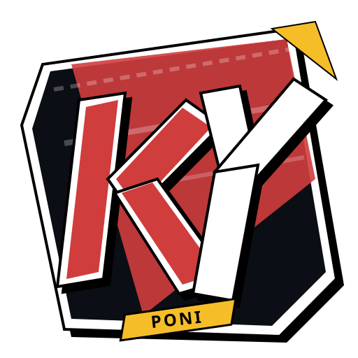

# KY-Poni ⚡

<p align="center">
  
</p>

<p align="center">
  <b>Stylized Game-Aesthetic Livestream Chat Overlay for OBS Studio</b><br>
  <i>Hadirkan chat box livestreaming unik berkarakter anime & video game di OBS tanpa kompromi performa.</i>
</p>

<p align="center">
  <a href="https://github.com/Milkyponi/KY-Poni/releases/latest"></a>
  
  
</p>

---

## 🎭 Fitur Unggulan

- 🎮 **Persona 5 Authentic Aesthetic (Flagship Theme)**:
  - Balon kata jajar genjang komik (*slanted origami ribbon*) berlatar hitam pekat dengan outline cel-shaded putih tebal.
  - Foto profil polaroid miring (*tilted square avatar*) dengan aksen duri komik (*comic shards*).
  - Tag username miring modular (Ungu Lavender, Toska Mint, Kuning Neon, Merah Phantom).
  - Banner alert donasi & membership dua tingkat (*two-tier split banner*).
  - Animasi cut-in heboh *All-Out Attack* saat menerima Super Chat.
- ⚡ **Zero-Quota YouTube Chat Ingest**:
  - Cukup masukkan Channel Handle (misal: `@MilkyPoni`) atau URL live stream.
  - Tidak perlu login Google, tidak perlu OAuth, dan **tidak memakan kuota API**.
- 📐 **4-Corner Screen Anchors (Fleksibilitas Posisi Layar)**:
  - Dukungan 4 sudut: Kiri Bawah, Kanan Bawah, Kiri Atas, Kanan Atas.
  - Sisi atas otomatis mendorong pesan dari atas ke bawah (*top-to-bottom flow*) agar tidak menutupi HUD game.
  - Sisi kanan otomatis membalik arah bayangan dan tab nama agar tidak terpotong tepi layar OBS.
- ⏱️ **Auto-Hide Timer & Retention Guard ("Keep Last N")**:
  - Pesan lama otomatis memudar setelah N detik.
  - Dilengkapi fitur penjaga: menahan pesan terakhir agar layar stream tidak menjadi kosong saat kolom chat sedang sepi.
- 🎨 **Kustomisasi Tipografi & Skala Bebas**:
  - Skala canvas keseluruhan (70% - 150%).
  - Ukuran font teks (12px - 26px).
  - Pilihan font kurasi: Space Grotesk, Bebas Neue, Inter, Bangers, Montserrat, VT323 (Pixel).
  - Custom text color picker & palet swatch neon.
- 📦 **Dynamic Remote Theme Catalog**:
  - Unduh dan pasang tema kustom tambahan langsung dari dalam aplikasi.
  - Komunitas dapat membuat tema mereka sendiri di folder `~/.config/ky-poni/themes/` atau `%APPDATA%/KY-Poni/themes/`.
- 🚀 **In-App Auto-Updater**:
  - Otomatis mengecek rilis pembaruan dari GitHub Releases.
  - Tombol update langsung di dalam aplikasi tanpa perlu download manual dari browser.

---

## 📥 Unduh & Instalasi

Unduh rilis portable terbaru pada halaman **[Releases](https://github.com/Milkyponi/KY-Poni/releases/latest)**:

| Platform | Format | Cara Menjalankan |
|---|---|---|
| **Windows** | `KY-Poni.exe` (Portable) | Double-click file `.exe`, aplikasi langsung terbuka tanpa instalasi. |
| **Linux** | `KY-Poni.AppImage` (Portable) | Beri izin eksekusi (`chmod +x KY-Poni*.AppImage`), lalu jalankan. |

---

## 🎬 Cara Memasang di OBS Studio

1. Buka aplikasi **KY-Poni**.
2. Masukkan handle channel YouTube Anda (contoh: `@MilkyPoni`) lalu klik **"⚡ Hubungkan Stream"**.
3. Sesuaikan tema, sudut layar, ukuran font, dan warna yang Anda sukai di dashboard.
4. Klik tombol **"📋 Salin"** pada kotak **OBS Browser Source URL**.
5. Buka **OBS Studio**:
   - Tambah Source baru: pilih **Browser**.
   - Paste URL yang telah disalin (contoh: `http://localhost:19840/overlay?theme=persona5&layout=vertical&pos=bottom-left`).
   - Atur Width: `450` dan Height: `800` (atau `800 x 300` untuk mode horizontal ticker).
   - Centang opsi *"Shutdown source when not visible"*.
6. Selesai! Chat livestream Anda akan muncul dengan animasi otentik di layar siaran.

---

## 🛠️ Pengembangan Lokal

```bash
# Clone repository
git clone https://github.com/Milkyponi/KY-Poni.git
cd KY-Poni

# Install dependensi
npm install

# Jalankan dalam mode desktop app
npm start

# Jalankan server background mandiri (opsional)
npm run start:server

# Eksekusi automated test suite
npm test

# Build paket distribusi portable
npm run build:linux   # Menghasilkan .AppImage di folder dist/
npm run build:win     # Menghasilkan .exe portable di folder dist/
```

---

## 📄 Lisensi

Proyek ini dirilis di bawah lisensi [MIT](LICENSE). Dikembangkan dengan penuh semangat di **Milky Brain HQ**.
