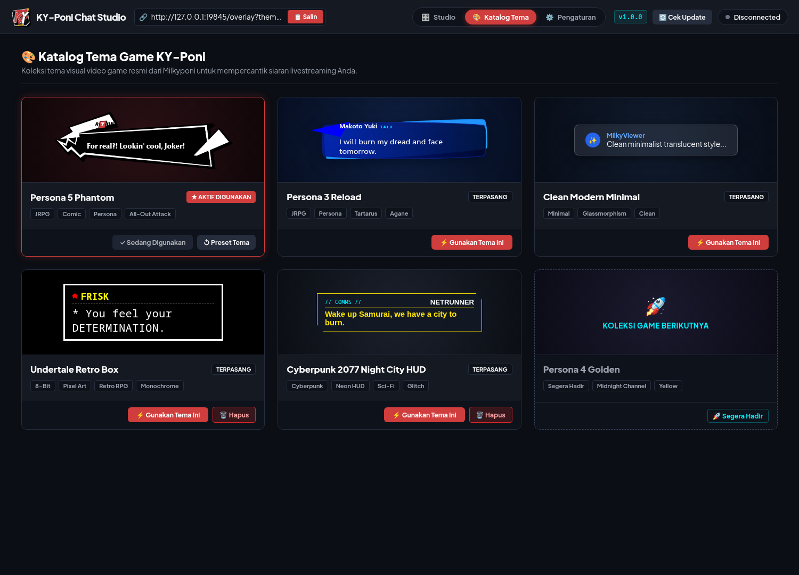
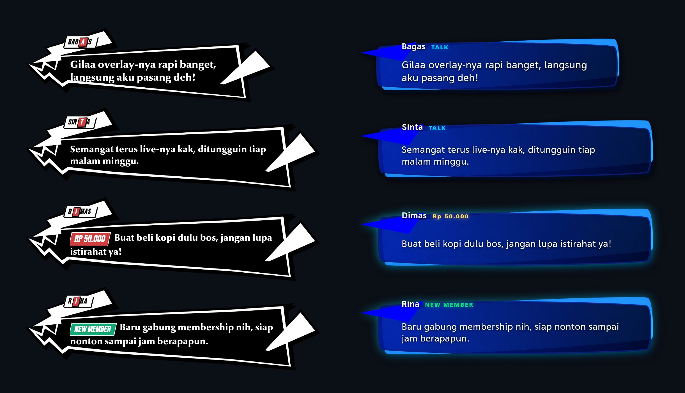
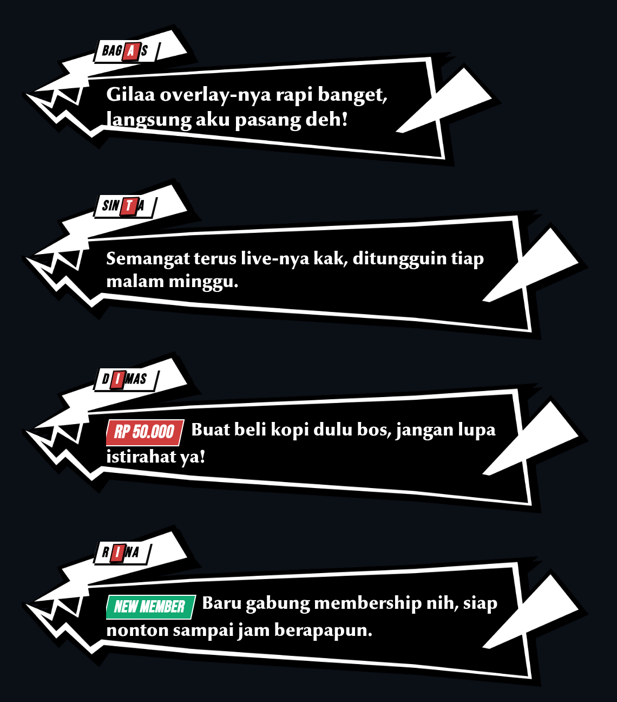
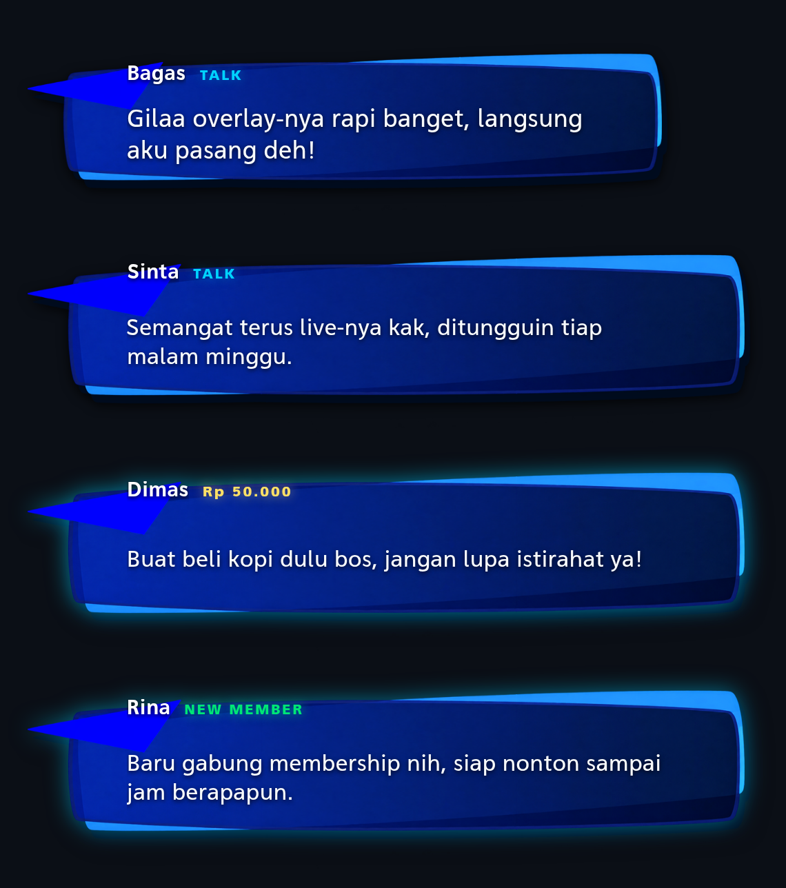

# KY-Poni

Overlay chat livestream bergaya antarmuka video game untuk OBS Studio. Berjalan lokal di komputer kamu, tanpa login, tanpa API key, tanpa langganan.



## Kenapa KY-Poni

Overlay chat yang umum dipakai memberi kotak yang bentuknya sama untuk semua streamer. KY-Poni menggantinya dengan bahasa visual dari game itu sendiri: balon dialog Persona 5, jendela percakapan Persona 3 Reload, textbox Undertale, sampai HUD Cyberpunk 2077.

Yang membuatnya beda:

- **Tanpa login dan tanpa API key.** Chat dibaca langsung dari YouTube lewat protokol internal, jadi kuota Google Data API tidak terpakai sama sekali.
- **Sepenuhnya lokal.** Satu proses di `localhost:19840`. Tidak ada server perantara, tidak ada data penonton yang dikirim ke mana pun.
- **Ringan dipakai bareng game.** Aplikasi desktop kecil; tidak berebut RAM dengan game yang sedang jalan.
- **Katalog tema terbuka.** Tema baru bisa ditambah tanpa merilis ulang aplikasi, dan kamu bisa membuat tema sendiri.

## Pratinjau



| Persona 5 Phantom | Persona 3 Reload |
| --- | --- |
|  |  |

Keduanya menampilkan chat biasa, Super Chat, dan member baru sekaligus.

## Unduh

Ambil berkas terbaru dari halaman [Releases](https://github.com/Milkyponi/KY-Poni/releases/latest).

| Platform | Berkas | Menjalankan |
| --- | --- | --- |
| Windows | `KY-Poni-<versi>.exe` | Klik dua kali. Portable, tanpa instalasi. |
| Linux | `KY-Poni-<versi>.AppImage` | `chmod +x` lalu jalankan. |

## Pasang di OBS

1. Buka KY-Poni, isi channel handle YouTube (misalnya `@MilkyPoni`), lalu hubungkan.
2. Atur tema, sudut layar, ukuran font, dan warna di dashboard.
3. Salin URL dari kotak OBS Browser Source — isinya **selalu** `http://localhost:19840/overlay`.
4. Di OBS, tambahkan source **Browser**, tempel URL tersebut.
5. Set ukuran source ke **1000 × 1000 px**. Posisi dan skala diatur lewat OBS seperti source biasa.

**URL itu statis.** Kamu tidak perlu menyalin ulang URL ketika mengganti tema, font, warna, atau
skala — overlay mengikuti pengaturan yang tersimpan di aplikasi. Perubahan kosmetik (skala, ukuran
font, jenis font, warna, durasi tampil) langsung terlihat tanpa memuat ulang source. Pergantian
tema, arah aliran, atau sudut layar akan memuat ulang overlay sendiri dalam sekejap.

Kalau kamu memakai URL versi lama yang masih berisi parameter (misalnya
`/overlay?theme=persona5`), tidak perlu panik: pengaturan dari aplikasi tetap yang dipakai,
jadi kamu otomatis menikmati fitur ini tanpa mengubah apa pun di OBS.

Kanvas 1000 × 1000 dipakai supaya teks tidak terpotong di skala maksimal dan tumpukan chat tetap muat di skala minimal.

## Tema

Tema bawaan: **Persona 5 Phantom**, **Persona 3 Reload**, dan **Clean Modern Minimal**. Tema tambahan (**Undertale**, **Cyberpunk 2077**) dipasang langsung dari tab Katalog Tema di dalam aplikasi.

Tema disimpan di folder data pengguna, jadi tetap ada setelah aplikasi diperbarui:

- Linux: `~/.config/ky-poni/themes/`
- Windows: `%APPDATA%\KY-Poni\themes\`

Ingin membuat tema sendiri? Kontraknya ada di [THEME_SPEC.md](THEME_SPEC.md) — cukup `theme.json`, `style.css`, dan `renderer.js`.

## Pengembangan

```bash
git clone https://github.com/Milkyponi/KY-Poni.git
cd KY-Poni
npm install
npm start        # jendela desktop
npm test         # suite otomatis
npm run build:linux
npm run build:win
```

Arsitektur dan keputusan teknis dijelaskan di [PROJECT.md](PROJECT.md), rencana fitur di [ROADMAP.md](ROADMAP.md).

## Dukung Pengembang

Kalau KY-Poni berguna buat stream kamu, dukung pengembangannya lewat [Trakteer](https://trakteer.id/milkyponi) — trakteer kopi Poni buat menjaga tema-tema baru tetap jalan. ☕

[](https://trakteer.id/milkyponi)

## Lisensi

[MIT](LICENSE).
